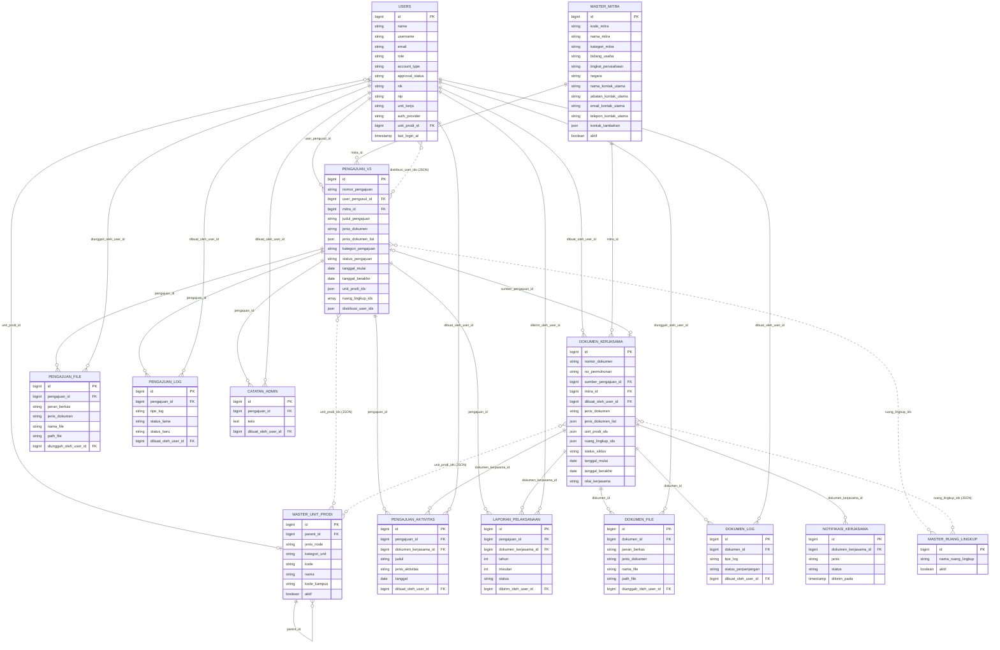

# ERD SIKERMA — kondisi saat ini

Disusun dari skema database yang berjalan (PostgreSQL), per 29 Oktober 2026. Dokumen
`database-redesign-simplified*` adalah rancangan awal dan sudah tidak sama dengan skema ini.

## 1. Yang berubah dibanding rancangan awal

| Perubahan | Sekarang |
|---|---|
| Pivot unit/prodi (`pengajuan_unit_prodi`, `dokumen_kerjasama_unit_prodi`) dan kolom `unit_prodi_id` | Dihapus. Diganti kolom JSON `unit_prodi_ids` di `pengajuan_v2` dan `dokumen_kerjasama` (id pertama = unit utama). |
| Tabel `kontak_mitra` | Dihapus. Diganti kolom JSON `master_mitra.kontak_tambahan`. |
| Fitur Inisiasi (`inisiasi*`) | Dihapus. |
| Jenis dokumen | `jenis_dokumen` (jenis utama) + `jenis_dokumen_list` (JSON, semua jenis bila MoU + MoA sekaligus) di pengajuan dan dokumen. |
| Berkas | `pengajuan_file` dan `dokumen_file` punya `jenis_dokumen`: MoU/MoA/IA (dokumen final) atau TOR/KAK/PROPOSAL/LAPORAN_KEGIATAN/LAINNYA (pendukung). |
| Hubungan pengajuan–dokumen | `dokumen_kerjasama.sumber_pengajuan_id` (FK). Dokumen juga bisa dibuat tanpa pengajuan. |

Tabel framework (`cache`, `jobs`, `sessions`, `migrations`, `failed_jobs`, `job_batches`,
`personal_access_tokens`, `password_reset_tokens`, `otp_codes`) dan `carousel_images` tidak
dimasukkan.

---

## 2. ERD Chen — entitas dan atribut

Notasi: **PK** = kunci (digaris bawah), *(M)* = multivalued, *(K)* = composite, *(D)* = derived,
**[W]** = entitas lemah.

### Entitas kuat

| Entitas | Atribut |
|---|---|
| **USER** | **id**, name, username, email, password, role, account_type, approval_status, nik, nip, phone, position, institution_name, unit_kerja, auth_provider, last_login_at |
| **MITRA** | **id**, kode_mitra, nama_mitra, kategori_mitra, bidang_usaha, tingkat_perusahaan, negara, alamat, website, email_mitra, no_telepon_mitra, whatsapp_mitra, aktif, *kontak_utama (K)*: nama, jabatan, email, telepon, *kontak_tambahan (M)*: nama, jabatan, email, telepon |
| **UNIT_PRODI** | **id**, kode, nama, jenis_node (jurusan/prodi/unit), kategori_unit, kode_kampus, aktif |
| **RUANG_LINGKUP** | **id**, nama_ruang_lingkup, aktif |
| **PENGAJUAN** | **id**, nomor_pengajuan, judul_pengajuan, deskripsi_pengajuan, kategori_pengajuan, status_pengajuan, diajukan_pada, keputusan, catatan_revisi, acc_internal_at, acc_mitra_at, final_approved_at, tahapan_stage, tahapan_group, tanggal_mulai, tanggal_berakhir, manfaat, luaran_kerja_sama, *jenis_dokumen (M)*: MoU/MoA/IA, *pengusul (K)*: nama, jabatan, email, whatsapp, *pic_polibatam (K)*: nama, jabatan, email, whatsapp |
| **DOKUMEN_KERJASAMA** | **id**, nomor_dokumen, no_permohonan, nama_dokumen, judul_dokumen, tanggal_mulai, tanggal_berakhir, tanggal_ttd, status_siklus, nilai_kerjasama, manfaat, luaran_kerja_sama, keterangan, follow_up, diarsipkan_pada, alasan_arsip, *jenis_dokumen (M)*: MoU/MoA/IA, *status_efektif (D)*, *snapshot (K)*: nama_mitra, nama_pengusul, email_pengusul, whatsapp_pengusul, jenis_mitra, bidang_usaha, tingkat_perusahaan, pic_polibatam |
| **LAPORAN_PELAKSANAAN** | **id**, tahun, triwulan, judul_kerjasama, kegiatan, capaian, hasil, kendala, tindak_lanjut, tautan_dokumentasi, status, file, *penanggung_jawab (K)*: nama, nip, *mengetahui (K)*: nama, nip, jabatan |
| **AKTIVITAS** | **id**, judul, jenis_aktivitas, tanggal, jumlah_peserta, deskripsi, pic_polibatam, pic_mitra, status |
| **NOTIFIKASI_KERJASAMA** | **id**, jenis, tanggal_berakhir_acuan, email_tujuan, status, keterangan, dikirim_pada |

### Entitas lemah [W]

| Entitas | Induk | Atribut |
|---|---|---|
| **BERKAS_PENGAJUAN** | PENGAJUAN | id, nama_file, path_file, mime_type, ukuran, peran_berkas, jenis_dokumen, diunggah_pada |
| **BERKAS_DOKUMEN** | DOKUMEN_KERJASAMA | id, nama_file, path_file, mime_type, ukuran, peran_berkas, jenis_dokumen, diunggah_pada |
| **LOG_PENGAJUAN** | PENGAJUAN | id, tipe_log, status_lama, status_baru, judul_log, isi_log, dibuat_pada |
| **LOG_DOKUMEN** | DOKUMEN_KERJASAMA | id, tipe_log, judul_log, isi_log, dibuat_pada, status_perpanjangan, tanggal_mulai_perpanjangan, tanggal_berakhir_perpanjangan, catatan_perpanjangan, diputuskan_pada |
| **CATATAN_ADMIN** | PENGAJUAN | id, teks, created_at |

### Relasi dan kardinalitas

| Relasi | Entitas | Kardinalitas | Dasar di database |
|---|---|---|---|
| mengajukan | USER – PENGAJUAN | 1 : N | FK `pengajuan_v2.user_pengusul_id` |
| membuat | USER – DOKUMEN_KERJASAMA | 1 : N | FK `dokumen_kerjasama.dibuat_oleh_user_id` |
| bermitra | MITRA – PENGAJUAN | 1 : N | FK `pengajuan_v2.mitra_id` |
| memiliki | MITRA – DOKUMEN_KERJASAMA | 1 : N | FK `dokumen_kerjasama.mitra_id` |
| menghasilkan | PENGAJUAN – DOKUMEN_KERJASAMA | 1 : 1 (dokumen boleh tanpa pengajuan) | FK `dokumen_kerjasama.sumber_pengajuan_id` |
| melibatkan | PENGAJUAN – UNIT_PRODI | **M : N** | JSON `pengajuan_v2.unit_prodi_ids` (tanpa FK) |
| melibatkan | DOKUMEN_KERJASAMA – UNIT_PRODI | **M : N** | JSON `dokumen_kerjasama.unit_prodi_ids` (tanpa FK) |
| mencakup | PENGAJUAN / DOKUMEN – RUANG_LINGKUP | **M : N** | `ruang_lingkup_ids` (tanpa FK) |
| menerima distribusi | USER – PENGAJUAN | M : N | JSON `pengajuan_v2.distribusi_user_ids` |
| bertugas di | USER – UNIT_PRODI | N : 1 | FK `users.unit_prodi_id` |
| membawahi | UNIT_PRODI – UNIT_PRODI | 1 : N (rekursif) | FK `master_unit_prodi.parent_id` |
| memiliki berkas | PENGAJUAN – BERKAS_PENGAJUAN | 1 : N | FK `pengajuan_file.pengajuan_id` |
| memiliki berkas | DOKUMEN_KERJASAMA – BERKAS_DOKUMEN | 1 : N | FK `dokumen_file.dokumen_id` |
| dicatat | PENGAJUAN – LOG_PENGAJUAN | 1 : N | FK `pengajuan_log.pengajuan_id` |
| dicatat | DOKUMEN_KERJASAMA – LOG_DOKUMEN | 1 : N | FK `dokumen_log.dokumen_id` |
| diberi catatan | PENGAJUAN – CATATAN_ADMIN | 1 : N | FK `catatan_admin.pengajuan_id` |
| dilaporkan dalam | DOKUMEN_KERJASAMA – LAPORAN_PELAKSANAAN | 1 : N | FK `laporan_pelaksanaan.dokumen_kerjasama_id` |
| mengirim | USER – LAPORAN_PELAKSANAAN | 1 : N | FK `laporan_pelaksanaan.dikirim_oleh_user_id` |
| memiliki aktivitas | PENGAJUAN / DOKUMEN – AKTIVITAS | 1 : N | FK `pengajuan_aktivitas.pengajuan_id`, `.dokumen_kerjasama_id` |
| memicu | DOKUMEN_KERJASAMA – NOTIFIKASI_KERJASAMA | 1 : N | FK `notifikasi_kerjasama.dokumen_kerjasama_id` |

Catatan penggambaran:
- Relasi **M : N** digambar langsung di antara dua entitas, tanpa entitas penghubung. Di
  database relasi ini disimpan sebagai kolom JSON, tetapi ERD Chen adalah model konseptual.
- **KONTAK TAMBAHAN** mitra digambar sebagai atribut *multivalued* dari MITRA, bukan entitas.
- **Jenis dokumen** (MoU/MoA/IA) pada PENGAJUAN dan DOKUMEN_KERJASAMA digambar sebagai atribut
  *multivalued*, karena satu pengajuan atau dokumen boleh memuat beberapa jenis.
- Berkas bertipe TOR/KAK/Proposal/Laporan Kegiatan/Lainnya adalah dokumen pendukung dan tidak
  dihitung sebagai jenis dokumen kerja sama.

---

## 3. ERD fisik (Mermaid)

Garis putus-putus = relasi logis tanpa foreign key (kolom JSON).

## 4. Hubungan yang tidak dijaga foreign key

Kolom JSON tidak bisa punya foreign key, jadi penjagaannya ada di kode:

| Kolom | Menunjuk ke | Penjaga |
|---|---|---|
| `unit_prodi_ids` | `master_unit_prodi.id` | Validasi `exists:master_unit_prodi,id` saat input; unit/prodi yang masih dipakai dokumen atau pengajuan tidak bisa dihapus (`MasterUnitProdiController`). |
| `ruang_lingkup_ids` | `master_ruang_lingkup.id` | Validasi saat input. |
| `distribusi_user_ids` | `users.id` | Validasi saat input. |
| `kontak_tambahan[].user_id` | `users.id` | Diisi dari akun pendaftar. |
